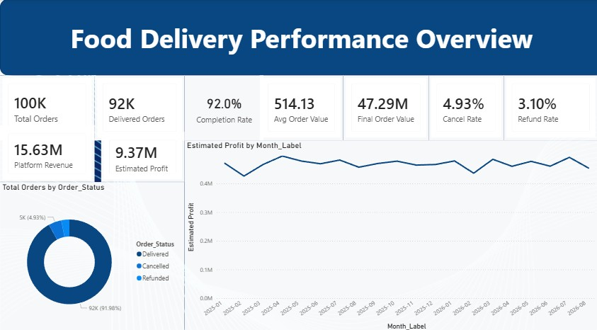
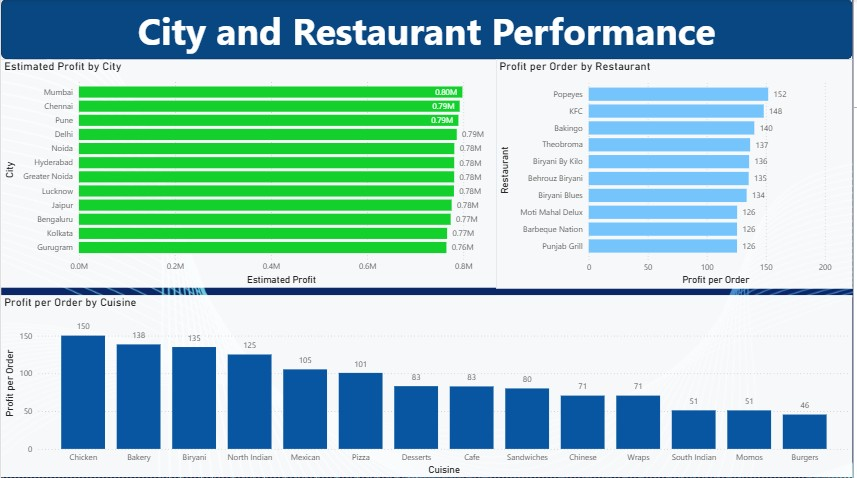
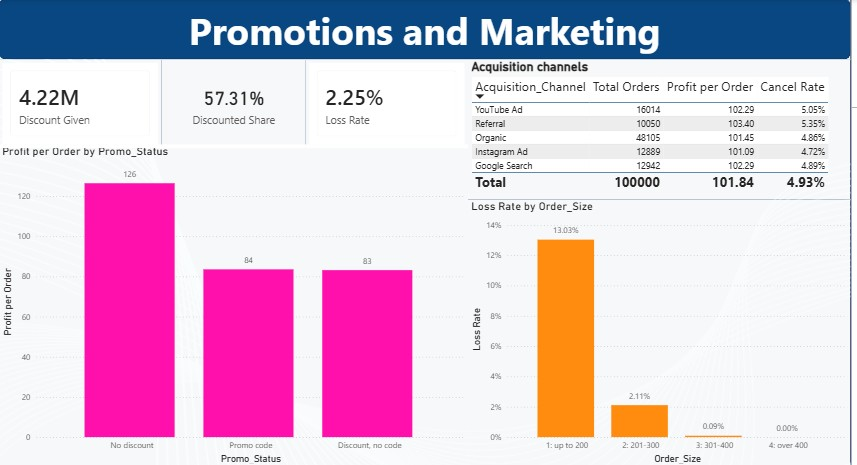
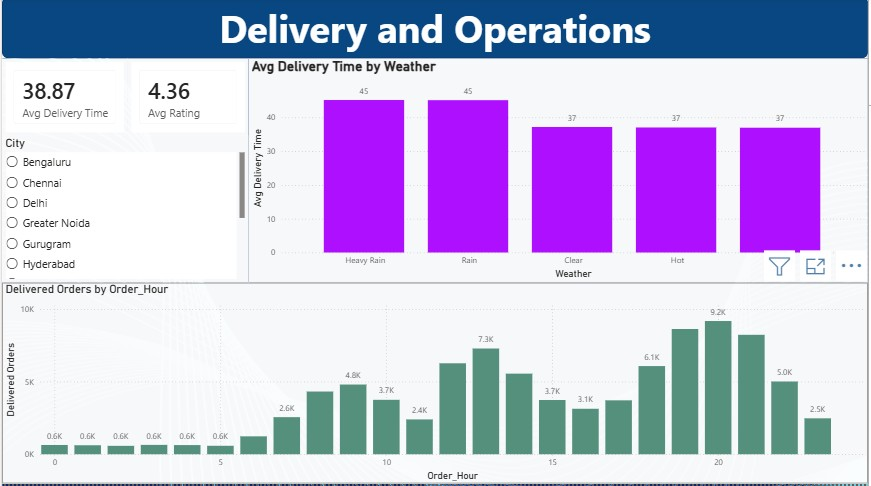

# Food Delivery Analytics

I analysed 100,000 food delivery orders to find where the business makes money and where it loses it.
I used Excel, Python, MySQL and Power BI, and I wrote down what I found and what I would do about it.

## About the data

- 100,000 orders, 36 columns, from Jan 2025 to Aug 2026
- 12 cities, 29 restaurants, 14 cuisines
- Each row is one order: price, discount, fees, tax, restaurant payout, platform revenue,
  estimated cost and profit, delivery time, rating, promo code and more
- 92% of orders were delivered, 4.9% were cancelled and 3.1% were refunded

The data file is **not** in this repo, because it has customer names. The data also looks
computer generated (for example, every city has almost the same number of orders), so what I
found is true for this dataset only.

## The questions I wanted to answer

1. Is the business growing?
2. Which cities, restaurants and food items earn the most profit?
3. Do discounts and promo codes help?
4. Why do some orders lose money?
5. Does bad weather or slow delivery hurt orders and ratings?
6. Which marketing channels bring good orders?
7. When is the business busiest?

## How I did it

1. **Excel:** looked at the data, checked for blanks, duplicates and wrong values, and wrote
   down every cleaning decision in a log.
2. **Python (pandas):** cleaned the data, converted the dates, checked the money columns and
   made a clean file. Then I explored the data and made charts.
3. **MySQL:** loaded the clean file and answered the business questions with SQL.
4. **Power BI:** built a 4 page dashboard from the same clean file.
5. **Reports:** wrote up my insights and recommendations.

One rule I used everywhere: money numbers (revenue, profit, order value) count **delivered
orders only**. Cancelled and refunded orders are left out.

I also checked that Python, SQL and Power BI give the same numbers. They do (see
`07_documentation/kpi_validation.md`).

## The main numbers

| | |
|---|---|
| Total orders | 100,000 |
| Delivered orders | 91,976 (92.0%) |
| Platform revenue | Rs 15,625,814 |
| Estimated profit | Rs 9,367,045 |
| Average order value | Rs 514.1 |

Profit is an estimate, not real accounting.

## What I found

- **Small orders lose money.** 13% of orders up to Rs 200 lost money. Orders over Rs 400
  never did. About 76% of all loss making orders were in the smallest group.
- **Discounts cut profit.** 57% of delivered orders got a discount, Rs 4.2M in total. An order
  with a discount earns about Rs 83, and one without earns Rs 126. The basket size is the same
  either way, and all three promo codes work the same.
- **Restaurants differ a lot.** Popeyes earns Rs 152 profit per order and McDonald's earns
  Rs 45. They get a similar number of orders. The difference is the price of the items.
- **Rain slows delivery by about 8 minutes** (45 against 37), but cancellations and ratings
  did not change.
- **Orders are flat** at about 150 a day for 20 months. The low Februaries are just a shorter month.
- **Cities, channels and payment methods are all about the same.** No clear winner.

You can read the full write up in [business_insights.md](06_reports/business_insights.md).

## Dashboard

**Page 1: Overview.** The main numbers, monthly profit and the order status split.

**Page 2: City and restaurant.** Cities are close together. Restaurants are not.

**Page 3: Promotions and marketing.** What discounts do, who loses money, and the channels.

**Page 4: Delivery and operations.** Delivery time by weather and orders by hour.

A PDF copy of the dashboard is in the `05_power_bi` folder.

## What I would do

The full list is in [recommendations.md](06_reports/recommendations.md). The two main ones:

1. Stop losing money on small orders, for example with a minimum order or a small order fee.
2. Review the discount plan. Test a group with no discount and see how many orders change.

I also suggest fixing the data gaps (see below) before making bigger decisions.

## Things to know

- The `Customer_ID` column is not reliable. The same ID shows up with different names, ages
  and cities, so I did not study repeat customers.
- Cost is an estimate, so profit is too.
- I cannot tell who pays for a discount, the platform or the restaurant.
- 14,593 orders have a discount but no promo code.
- These are patterns in the data, not proof of what causes them.

## Folders

| Folder | What is in it |
|---|---|
| `01_data` | A note about the data (the data itself is not shared) |
| `02_excel` | The data quality report and cleaning log |
| `03_python` | Notebook for cleaning and exploring the data |
| `04_MySQL` | SQL queries |
| `05_power_bi` | Dashboard screenshots and PDF |
| `06_reports` | Business insights and recommendations |
| `07_documentation` | KPI check across Python, SQL and Power BI |

## To run it yourself

You need your own copy of the data file. Put it in `01_data`, then open the notebook in
`03_python`. For SQL, load the cleaned file into a MySQL table called `orders`.

Tools: Excel, Python (pandas, matplotlib), MySQL, Power BI.

---

Sikandar Khan · [GitHub](https://github.com/sikandar-data-analyst)
 [LinkedIn ](https://www.linkedin.com/in/sikandar-khan-5ba465422/)
